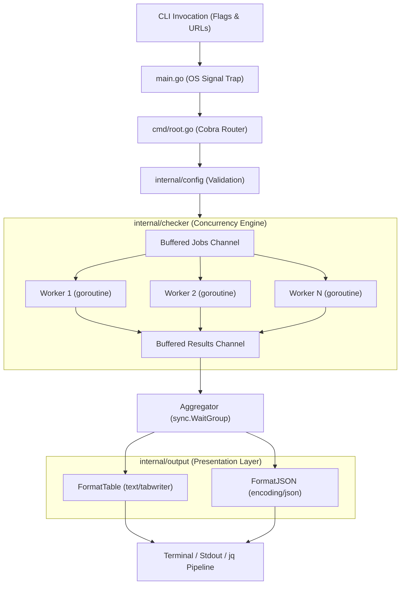

# Axon-CLI

[](https://golang.org)
[]()
[]()
[](LICENSE)
[]()

> High-performance, concurrent command-line utility built in Go to audit endpoint health, monitor multi-node infrastructure, and parse network telemetry with zero runtime dependencies.

---

## 1. Overview

**Axon-CLI** is a compiled, standalone systems diagnostic tool designed to eliminate operational toil when inspecting fleets of HTTP/TCP services. Rather than relying on slow sequential curl scripts or heavy monitoring agents, Axon dispatches probes across an asynchronous, bounded worker pool—auditing dozens or hundreds of distributed endpoints concurrently without CPU thrashing or file descriptor exhaustion.

Built according to strict **POSIX Unix standards**, Axon supports human-readable terminal tables alongside clean, machine-parseable JSON streams that pipe seamlessly into UNIX utilities (`jq`, `awk`) and automated CI/CD deployment gates.

---

## 2. Core Architecture & Concurrency Pipeline

Axon utilizes an inside-out clean architecture with a fixed-size **worker pool** feeding off buffered channels, synchronized via `sync.WaitGroup` and guarded by Go's `context.Context` for instant signal cancellation.



### Architectural Highlights

* **Bounded Goroutine Worker Pool:** Avoids the anti-pattern of unbounded concurrency. A user auditing 1,000 endpoints with `--workers 10` runs exactly 10 persistent worker goroutines, eliminating `socket: too many open files` errors and memory spikes.
* **Context-Aware Signal Trapping (`Ctrl+C`):** Binds `signal.NotifyContext` to POSIX `SIGINT`/`SIGTERM`. Terminating the process immediately aborts active network sockets via `http.NewRequestWithContext` without leaving orphaned background connections.
* **Zero-Leak Connection Pooling:** Configured `http.Transport` manages idle connection lifecycles and guarantees explicit `resp.Body.Close()` execution to prevent TCP socket leaks.
* **Dual Presentation Modes:** Decoupled formatters accept an `io.Writer` interface, outputting dynamically aligned columns via `text/tabwriter` for operators or indented JSON for automated pipelines.

---

## 3. Installation & Distribution

### Pre-Compiled Binaries (Recommended)
Download the latest standalone executable for your operating system from [GitHub Releases](https://github.com/cllong15/axon-cli/releases):

| Operating System | Architecture | Package Format |
| :--- | :--- | :--- |
| **Linux** | `amd64` (x86_64), `arm64` | `.tar.gz` |
| **macOS** | `amd64` (Intel), `arm64` (Apple Silicon) | `.tar.gz` |
| **Windows** | `amd64` | `.zip` / `.exe` |

### Build from Source
Ensure **Go 1.26+** is installed:
```bash
git clone https://github.com/cllong15/axon-cli.git
cd axon-cli
go build -o axon .
```

---

## 4. Usage & Command Reference

### Basic Endpoint Audit
Probe multiple URLs concurrently using default settings (10 workers, 5s timeout, table output):
```bash
axon https://api.github.com https://httpbin.org/status/200 https://httpbin.org/status/503
```

**Terminal Output:**
```text
URL                                STATUS   LATENCY   ERROR
https://api.github.com             200      142ms     -
https://httpbin.org/status/200     200      284ms     -
https://httpbin.org/status/503     503      310ms     -
```

### High-Throughput Fleet Audit
Adjust concurrency and request timeouts for large fleets:
```bash
axon -w 25 -t 2s https://node-01.internal https://node-02.internal https://node-03.internal
```

### UNIX Piping & CI/CD JSON Integration
Generate machine-parseable JSON and filter anomalies using `jq`:
```bash
axon -f json https://service-a.com https://service-b.com | jq '.[] | select(.status_code != 200)'
```

**JSON Output:**
```json
[
  {
    "url": "https://service-b.com",
    "status_code": 500,
    "latency": 84210000,
    "error": ""
  }
]
```

### Command-Line Flags

| Flag | Short | Default | Description |
| :--- | :---: | :---: | :--- |
| `--workers` | `-w` | `10` | Maximum number of concurrent worker goroutines |
| `--timeout` | `-t` | `5s` | Per-request network timeout duration |
| `--format` | `-f` | `table` | Presentation format (`table` or `json`) |
| `--help` | `-h` | — | Display help information |

---

## 5. Verification & Test Suite

Axon enforces test-driven reliability. Every internal layer is covered by comprehensive unit and integration suites:

```bash
# Run all unit and integration tests with coverage
go test -count=1 -cover ./...
```

### Package Coverage Matrix

| Package | Test Scope & Scenarios Covered | Statement Coverage |
| :--- | :--- | :---: |
| **`cmd`** | Flag parsing, validation gates, missing target usage, table & JSON formatting | **100.0%** |
| **`internal/checker`** | Mock HTTP servers (`httptest`), timeouts, context cancellation, network errors, concurrency clamps | **100.0%** |
| **`internal/config`** | Boundary assertions, zero/negative worker limits, timeout invariants, format validation | **100.0%** |
| **`internal/output`** | Dynamic column auto-alignment, round-trip JSON deserialization, write error bubbling | **100.0%** |
| **Total Application** | **Comprehensive end-to-end coverage** | **100.0%** |

---

## 6. Project Structure

```text
axon-cli/
├── .github/
│   └── workflows/
│       ├── ci.yml              # Automated testing, static analysis, and build verification
│       └── release.yml         # Automated multi-platform compilation on tag push
├── cmd/
│   ├── root.go                 # Cobra command routing and flag binding
│   └── root_test.go            # CLI integration tests
├── internal/
│   ├── checker/
│   │   ├── client.go           # Configured http.Client with connection pooling
│   │   ├── worker_pool.go      # Concurrency engine with bounded channels and WaitGroup
│   │   └── worker_pool_test.go # Mock server concurrency test suite
│   ├── config/
│   │   ├── config.go           # Typed configuration struct and validation invariants
│   │   └── config_test.go      # Boundary validation test suite
│   └── output/
│       ├── json.go             # Indented JSON serializer
│       ├── table.go            # Column-aligned text/tabwriter formatter
│       └── output_test.go      # Presentation test suite
├── .goreleaser.yaml            # Cross-compilation specification for Linux, macOS, and Windows
├── go.mod
├── go.sum
├── LICENSE                     # MIT License
├── main.go                     # Application entry point with OS signal trap
└── README.md
```

---

## 7. License

Distributed under the **MIT License**. See [`LICENSE`](LICENSE) for complete details.
